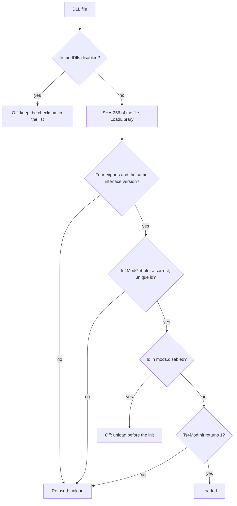

# The DLL mods

## The folder

- The DLL mods are in `%LOCALAPPDATA%\Sims4Mods\dlls`, next to `mods.json` and `logs`.
- The game folder is read only, so the extender never loads a DLL mod from it.
- `TS4_MODS_SETTINGS` moves only `mods.json`. The folder of the DLL mods stays.
- `python tools\install.py mods add <dll>` copies a DLL mod to the folder.
- The DLLs load in the order of their file names, in the [first tick](start.md).

## The checks of one DLL

- The four exports are `Ts4ModApiVersion`, `Ts4ModGetInfo`, `Ts4ModInit` and `Ts4ModShutdown`.
- An id has 1 to 64 letters, digits, `-` and `_`.
- A refused mod loses all its registrations. The game continues.
- The log and the list of the mods give the file, the SHA-256, the state, the reason, the id, the name and the
  version of each DLL.

## A guard on each call

- Each call into a mod has a guard. An access violation stops all calls to that mod (state `Failed`).
- The DLL of a failed mod stays in memory, because its code can still be in use.
- The extender owns each DLL handle. At the end it calls `Ts4ModShutdown`, removes the registrations and unloads
  the DLL.

The full sequence of a mod load is in the
[design of common](https://github.com/sims-4-modded/common/blob/main/docs/design.md#the-interface-between-the-extender-and-a-mod).
