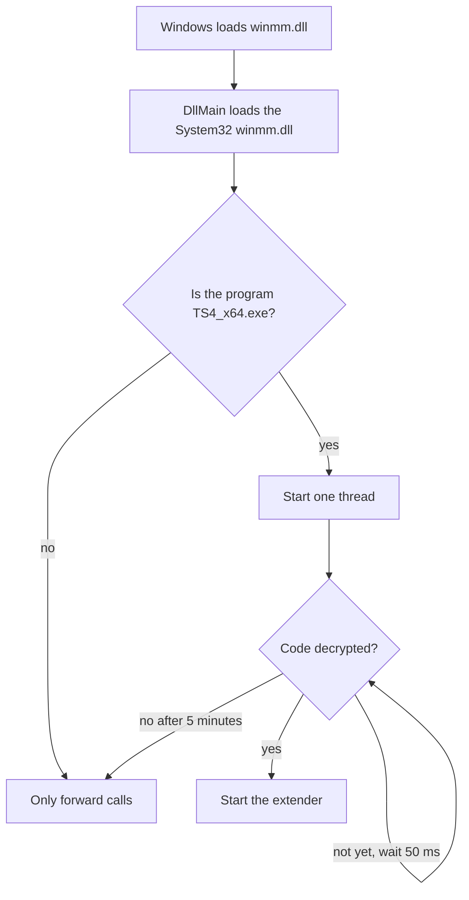

# How the game loads the extender

The extender is a proxy of `winmm.dll`. `TS4_x64.exe` and `Simulation_x64.dll` import `WINMM.dll`, and Windows finds
it in `Game\Bin` first. A proxy `version.dll` does not work: the game always loads the System32 copy first. The
research is in [research/loader/load_notes_via_proxy_winmm.md.md](research/load_notes_via_proxy_winmm.md).

- The proxy forwards all 181 exports of the System32 `winmm.dll` with their names and ordinals. Ordinal 2 has no
  name. `tools/proxy_exports.py` makes the export list from the system DLL.
- The marker export `Ts4ModLoaderVersion` tells the install tool that a `winmm.dll` is ours.
- The DLL imports only KERNEL32 at the start. The other system DLLs load at their first call (delay load).
- `tools/install.py` puts the DLL in `Game\Bin` and removes it. It refuses a `winmm.dll` that is not ours.

## Two processes

The EA activation wrapper starts `TS4_x64.exe` two times. The first process (the stub) can load the proxy before the
decryption, and then it stops. The proxy only forwards calls there.

## The wait for the decryption

The exe is encrypted on disk. The start thread measures the entropy of the `.text` section.

- Encrypted code has an entropy of almost 8 bits for each byte. The decrypted code has approximately 6.5.
- The code is decrypted when two samples are below 7.5 and almost the same.
- The stub process stops before that. DllMain then writes one line to `loader.log`.

Then the extender starts: see [start.md](start.md).
