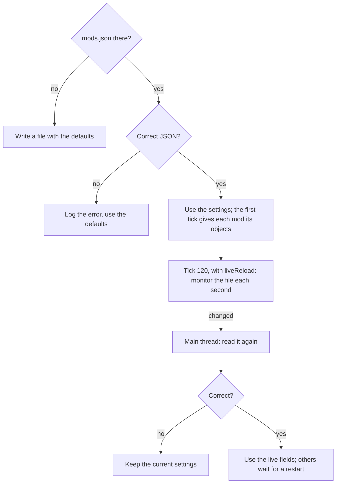

# The settings file

The settings file is `%LOCALAPPDATA%\Sims4Mods\mods.json`. `TS4_MODS_SETTINGS` gives another path.

- The extender owns six top-level keys. Each other top-level object belongs to a mod.
- A mod cannot register a settings section with a key of the extender.
- A missing field keeps its default.

## The keys of the extender

- `tickHook` (default `false`): one heartbeat line in the log in each 3600 ticks. After a restart.
- `liveReload` (default `true`): monitor `mods.json`, use the hotkeys and the menu bar. After a restart.
- `hotkeys`: `enabled`, `messages`, `messageSeconds`, and the hotkey of each action by its name.
- `overlay`: `enabled` (after a restart), `fontScale` (empty: from the window height), `pinned` (live).
- `mods.disabled`: the ids of the DLL mods that are off. After a restart.
- `modDlls.disabled`: the file names of the DLLs that do not load. After a restart. The
  [start-up guard](startup-guard.md) adds to it.

Masters of Albion has `frameHook` in place of `tickHook`. Its keys `objects`, `maps` and `mods.map` are not ported.

## The life of the file

- A change in the menu bar writes only its own fields. The other fields of the file stay.
- The action `reloadSettings` (`Ctrl+Shift+F10`) reads the file again. `showSettings` (`Ctrl+Shift+F11`) writes the
  settings to the log.
