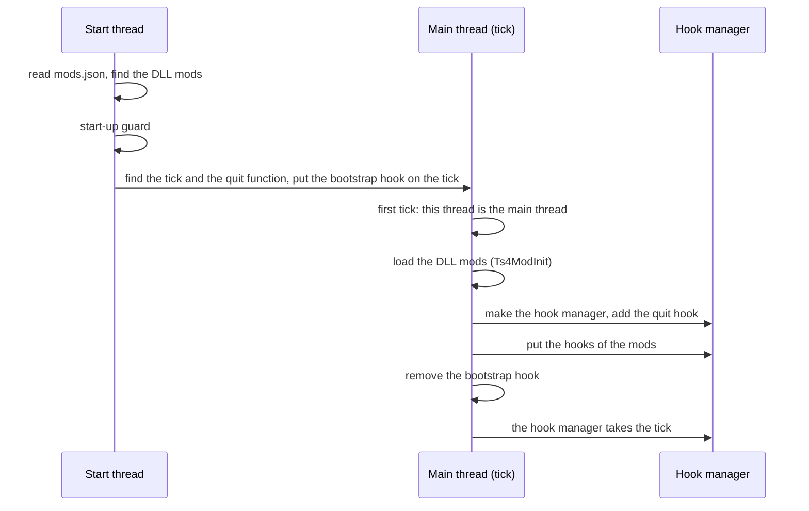

# The start

The start has three parts: the start thread, the first tick and the hand-over of the tick.

## The start thread

- Reads `mods.json`. If there is no file, it writes a file with the defaults.
- Finds the DLL files in the folder of the DLL mods.
- Starts the [start-up guard](startup-guard.md).
- Registers the settings, the actions and the queries of the extender.
- Finds the tick and the quit function by signature. Puts the bootstrap hook (its own MinHook hook) on the tick.

## The first tick

- The thread of the first tick is the main thread.
- The extender loads the [DLL mods](dll-mods.md) here, gives them their settings and reads their hotkeys.
- The DLL mods load before the other hooks go on. A mod that reads the game code in its init finds the original
  bytes, except on the tick function.
- The extender makes the hook manager and adds the [quit](quit.md) hook.
- Each tick tries the hooks of the mods until their modules are loaded. Then the bootstrap hook removes itself, and
  the hook manager takes the tick, with the callbacks of the mods on the tick function.

**Each tick** runs the frame callbacks in this order: the hotkeys, the [menu bar](menu-bar.md), the steps of the
start-up guard and the tasks. The hotkeys and the menu bar run only with `liveReload`.

If the extender finds no tick, no DLL mod loads, and no hook, menu bar or task runs.
