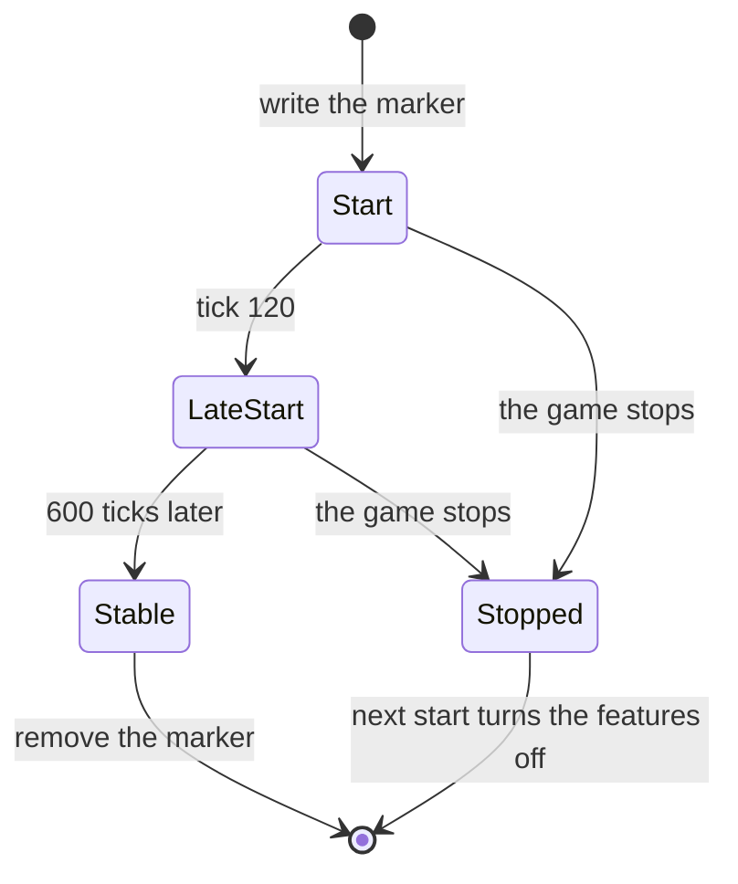

# The start-up guard

The guard stops a bad feature from stopping the game at each start.

- At the start, the extender writes a marker file. The marker has the process, the versions, the time, the stage
  and the features of this start.
- The features are the menu bar and each DLL mod (`dll:<file>`).
- Before each risky step, the extender writes the stage to the marker, for example `mod DLL better_needs.dll` or
  `menu bar`.
- When the start is stable, the extender removes the marker.
- If the marker is there at the next start, the last start did not complete. Each feature of that start stays off.

## The steps

- **Start:** the start thread writes the marker. The first tick loads the DLL mods, one stage for each DLL.
- **Late start** (tick 120): the monitor of `mods.json` and the menu bar start.
- **Stable** (tick 720): the extender removes the marker.
- **Quit:** the quit hook also removes the marker.

## After a start that did not complete

- The log tells it in upper case, with the last stage.
- The extender adds each DLL of that start to `modDlls.disabled`, and sets `overlay.enabled` to `false`.
- It writes these changes to `mods.json`. The user turns the features on again.
- If the marker text is not correct, each feature of this start stays off.
