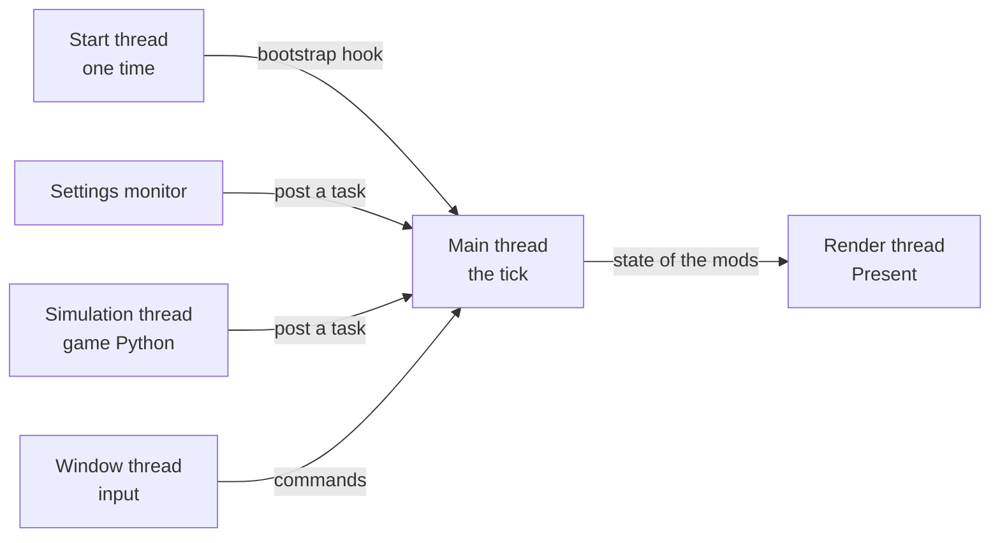

# The threads

Six threads of the game process are important to the extender.

- **The start thread** waits for the decryption, reads `mods.json` and puts the bootstrap hook. Then it stops.
- **The main thread** of the client runs the main loop and calls the tick in each frame, also at the main menu and on
  the load screens. The extender runs these on it: `Ts4ModInit`, the hook callbacks, the hotkeys, the tasks, the
  queries and the menu bar logic.
- **The simulation thread** runs the simulation, the game Python and the cheat commands. A call from a script mod
  into a DLL mod comes on this thread.
- **The render thread** presents the swap chain. The menu bar draws there. No function of a mod runs there.
- **The settings monitor** checks `mods.json` each second, from the late start.

The game window also has a thread that gives the input to the menu bar.

## Rules for a mod

- To change the client from the simulation thread, a mod posts a task, or it keeps the shared state under a lock.
- `log`, `postTask` and `listQueries` work from any thread.
- The log tells the thread of the tick in the first 6000 ticks. It also tells the thread that loaded
  `Simulation_x64.dll`.

The full rules are in `Ts4ModApi.h` of common.
